<div align="center">


# Rivulet

**Built for simplicity.**

A native Apple TV app for Plex, Jellyfin, and Live TV.

<a href="https://apps.apple.com/us/app/rivulet-for-plex/id6756892857">
  
</a>
&nbsp;
<a href="https://testflight.apple.com/join/TcCsF5As">
  
</a>

</div>

---

<div align="center">

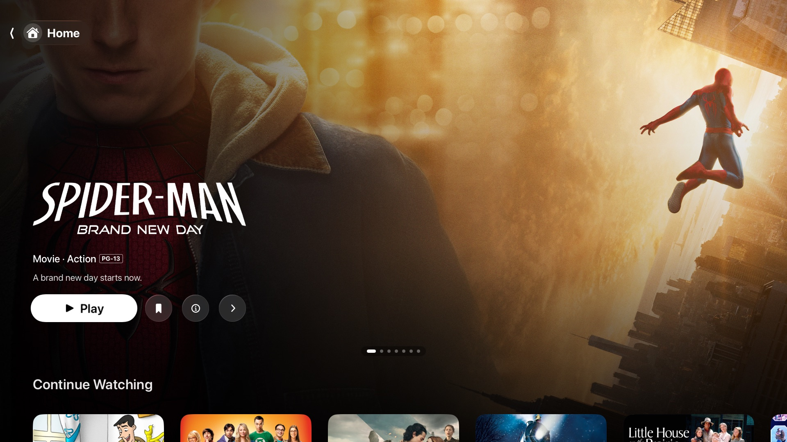

</div>

<div align="center">

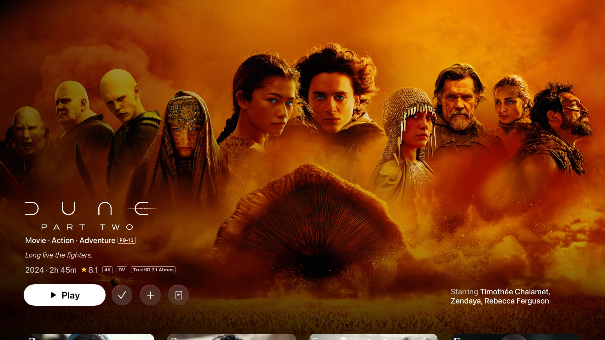
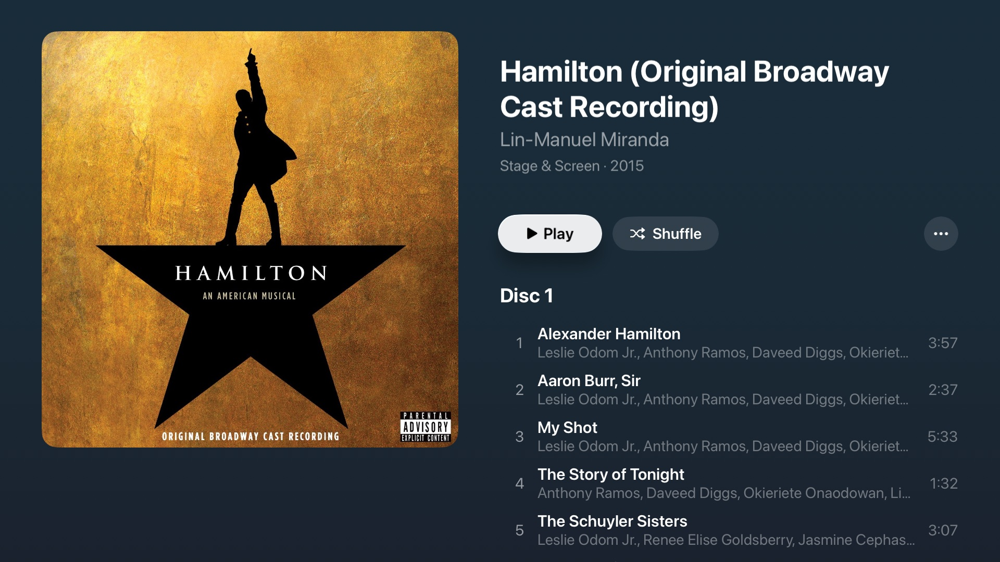

</div>

---

<br></br>

**Rivulet is built for Apple TV first. I care a lot about its speed, performance, and simplicity in tvOS.**

**If you like it, please share it around.**

This project is opinionated. All suggestions and ideas are always welcome, but please don’t be offended if I decline an enhancement or feature suggestion. 

_A camel is a horse designed by a committee. I don’t want Rivulet to be a camel._


## Why this exists
I began this project in Decemeber 2025. At the time there was quite a lack of Plex player alternatives, especially for tvOS (not much so anymore). My goals for the app were/are:
- **Simplicity**: what is the best design to get me to the media I want to watch.
- **Live TV**: Plex's live TV is, to put it nicely, sub-par. I've spent too long trying to get it to work well for me (kudos if you don't have this problem). I don't want live TV in a separate app, so this solves my problems.
- **HomePod Integration**: the Plex app has never worked well when setting HomePod as the default audio output on my Apple TV. It hurts to have a HomePod sitting there collecting dust while my sub-par TV speakers play sound. This app helps the hurt.
- **Apple-Esque**: I enjoy Apple’s designs and apps, and enjoy the challenge of creating an app that feels native to the Apple ecosystem.
<br></br>
## Live TV

Rivulet works with several kinds of Live TV source. You don't need a Plex or Jellyfin server. Add just a Live TV source and the app opens straight to Live TV.

- **What's On**: what's airing now, what starts soon, and a For You row that learns what you watch.
- **Guide**: standard guide layout if you want.
- **Multiview**: watch up to four channels at once.
- **Scores**: live scores if thats your thing. NFL, college football, NBA, MLB, and NHL.
- **Sources**: Dispatcharr, Plex Live TV (HDHomeRun and DVB tuners), Xtream Codes, and any M3U/XMLTV playlist.

<div align="center">

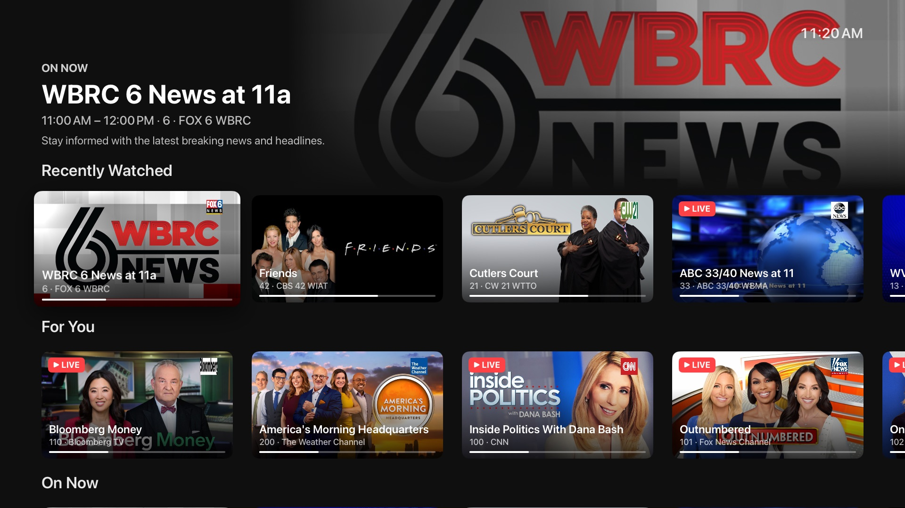
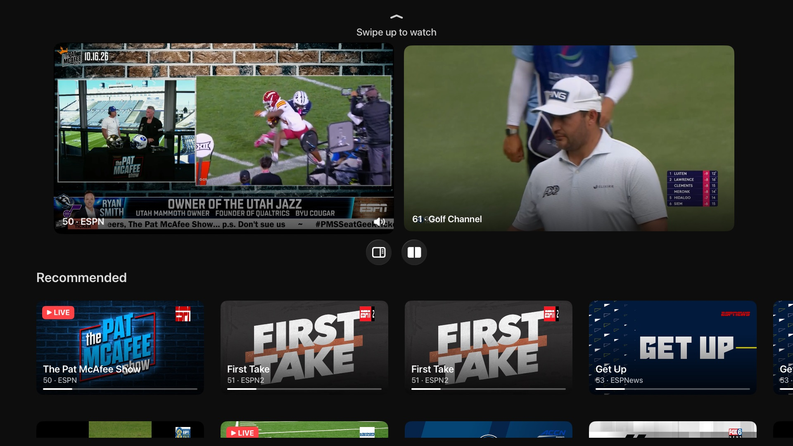

</div>
<br></br>

## Insights

This is a fun one. Open insights from the bottom row buttons while playing media. You get trivia about the movie or episode you’re watching: production stories, casting, adaptation changes, fan lore, and more.

<div align="center">

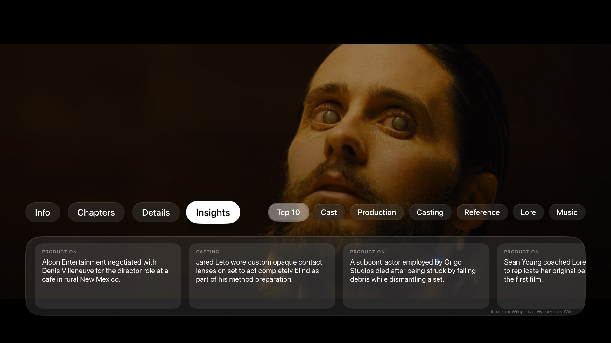
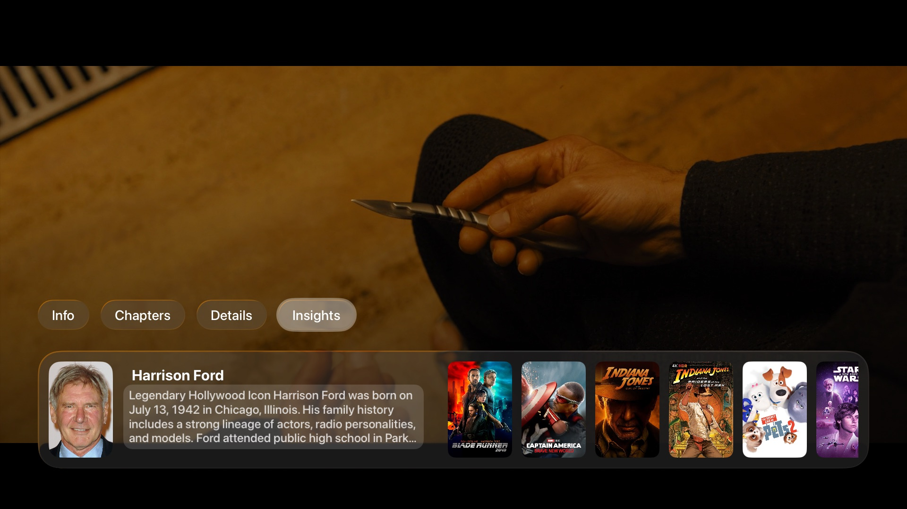

</div>
<br></br>
## Video player

Playback runs on [AetherEngine](https://github.com/superuser404notfound/AetherEngine) 7.50.0.

- **Containers**: MKV, MP4, WebM, MPEG-TS, AVI, WMV, OGG, FLV, and more.
- **Video**: H.264 and HEVC (including 10-bit) decode in hardware. AV1, VP9, MPEG-2, VC-1, MPEG-4 Part 2, and almost anything else FFmpeg can decode play in software. Interlaced broadcasts are deinterlaced on the GPU.
- **HDR**: HDR10, HDR10+, HLG, and Dolby Vision profiles 5, 8.1, and 8.4. Profile 7 FEL plays with both layers composed on a Dolby Vision TV. Profile 7 MEL, and FEL titles too heavy to compose in real time, play as 8.1. Without a Dolby Vision TV, Profile 7 plays its HDR10 base layer.
- **Audio**: Apple TV can't bitstream audio, so everything goes through tvOS. AAC, AC3, E-AC3, FLAC, and ALAC are handed to tvOS as-is, and it outputs them the same way it does in Apple's own apps. Atmos in E-AC3 reaches an Atmos receiver as Dolby MAT, and everything else goes out as multichannel PCM or Dolby Digital, depending on your Apple TV audio settings. TrueHD, DTS, DTS-HD MA, Opus, Vorbis, and PCM are decoded by Rivulet first and reach tvOS as lossless multichannel audio. TrueHD and DTS-HD MA stay lossless, but your receiver will show PCM instead of the original format.
- **Height channels**: Settings > Playback > Height Speakers renders TrueHD Atmos and DTS:X heights as lossless PCM over HDMI, including during Dolby Vision Profile 7 FEL playback. AirPlay uses lossy APAC instead; the FEL picture cannot use AirPlay. Off plays channel audio without object heights. DTS:X needs a 7.1.4 or 9.1.6 layout.
- **Subtitles**: SRT, ASS/SSA, and WebVTT, plus image subtitles (PGS, DVB, DVD/VobSub), CEA-608 closed captions, DVB teletext, and external subtitle files from your server. ASS/SSA renders through libass with its original styling and embedded fonts.
- **Stream quality**: direct play by default, or pick a transcode quality when bandwidth is tight.
- **Content filtering** (work in progress): mute language and skip scenes on your device, from the title's subtitles or an imported EDL list. The file is never touched.

<br></br>
## Music

- Album, artist, and playlist browsing, modeled on Apple's Music app for tvOS. I think its beautiful.
- Lyrics, synced when the source provides timestamps.
- System Now Playing controls. HomePod, AirPods, Siri Remote, and Control Center all work.
<br></br>
## iPhone and iPad

The iOS app follows the Apple TV app and should have all the features one needs. It shares the same Core code as the tvOS app.

<div align="center">

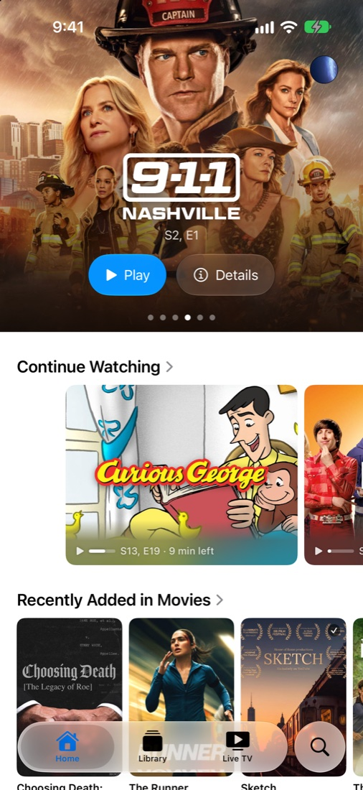
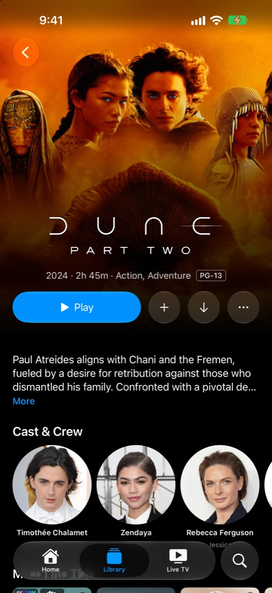
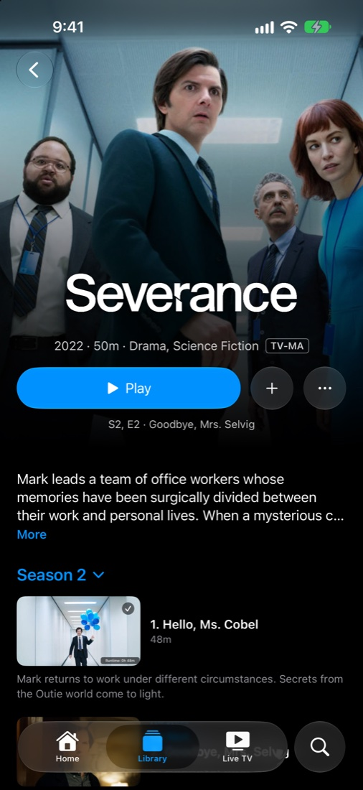
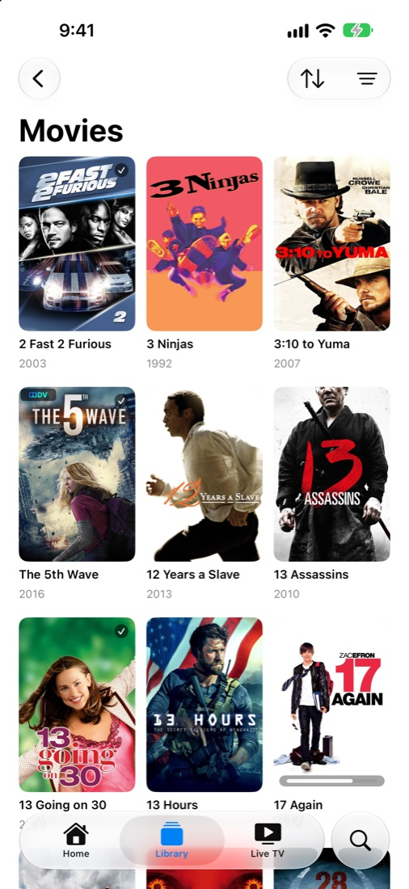

</div>

---
<br></br>
> [!IMPORTANT]
> ## Rivulet is free, but not for sale.
>
> Licensed under [PolyForm Noncommercial 1.0.0](LICENSE). You may **clone it, run it, modify it, share it, and contribute back** for personal, educational, research, hobby, or any other noncommercial use.
>
> You may **not** sell Rivulet, charge for access to it, or bundle it (or any derivative of it) into a paid app, product, or service. **Anything derived from this code inherits the same restriction.** I'd rather give this away than watch someone else charge for it.

---
<br></br>
## Building

Requires Xcode 27. Copy the secrets template once (placeholder values are fine), then open the project:

```bash
cp RivuletCore/Config/Secrets.swift.template RivuletCore/Config/Secrets.swift
open Rivulet.xcodeproj
```

`Rivulet` is the tvOS scheme and `Rivulet iOS` is the iPhone and iPad scheme. `Rivulet/` holds the tvOS app, `RivuletiOS/` the iOS app, and `RivuletCore/` the code both share. See `CLAUDE.md` for the architecture.
<br></br>
## Contributing

Found a bug? [Open an issue](../../issues/new/choose) and pick the platform (tvOS or iOS). If the same bug shows up on both, open one issue per platform so each fix is tracked on its own.

I welcome all contributions from any level of developer. I welcome contributions from LLMs too as long as they are checked and tested.

**If you do contribute, please build and test on an actual Apple TV. The simulator is close, but does not mimic the Apple TV fully.**

By submitting a pull request, you agree to license your contribution under the same terms as Rivulet (PolyForm Noncommercial 1.0.0, see [LICENSE](LICENSE)).
<br></br>
## License

Rivulet is licensed under the [PolyForm Noncommercial License 1.0.0](LICENSE).

Everything here is free to use, read, fork, and build on. The only thing you can't do is sell it. I'd rather give this away than watch someone else charge for it.

In short: clone it, run it, modify it, share it, contribute back, for personal, educational, research, hobby, or other noncommercial use. You may not use Rivulet (or anything derived from it) for commercial purposes, including selling it, charging for access to it, or bundling it into a paid product or service.

This restriction is not decorative. If you ship Rivulet's code (in whole or in part, modified or not) inside something you sell, you are infringing the copyright in this project. If you spot a commercial app built on this code, please [open an issue](../../issues) so it can be reported to the relevant platform (App Store, GitHub, etc.).

Third-party components retain their original licenses. FFmpeg is included under LGPL-2.1+; libdovi under MIT. See [LICENSE](LICENSE) for details.
<br></br>
## Acknowledgments

- [AetherEngine](https://github.com/superuser404notfound/AetherEngine): the playback engine
- [FFmpeg](https://ffmpeg.org/): demuxing, decoding, and remuxing
- [libdovi](https://github.com/quietvoid/dovi_tool): Dolby Vision RPU handling
- [libass](https://github.com/libass/libass): ASS/SSA subtitle rendering
- [Plex](https://plex.tv/): media server platform
- [Jellyfin](https://jellyfin.org/): open source media server
- [Dispatcharr](https://github.com/Dispatcharr/Dispatcharr): IPTV management
- [TMDB](https://www.themoviedb.org/): artwork and metadata for Discover

---

<div align="center">

Rivulet is not affiliated with or endorsed by Plex, Inc. or the Jellyfin project.

</div>
